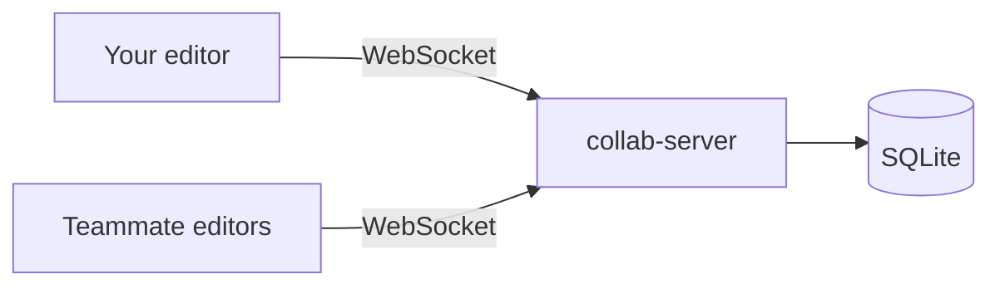

# Editor Collaboration

See where your teammates are in the Unreal Editor, jump to the same place in one click, chat, and pin comments on maps and graphs. The plugin is **editor only**. It never ships in a packaged game. Maps and assets stay synchronized through Git. The plugin only shares presence.

<a href="https://www.fab.com/portal/listings/562248b3-2a46-4076-ba0d-b812b4d7d659/" class="button primary">Get it on Fab</a>

<table data-view="cards"><thead><tr><th></th><th></th><th></th><th data-hidden data-card-target data-type="content-ref"></th></tr></thead><tbody><tr><td><h3><i class="fa-plug" style="color:$primary;">:plug:</i></h3></td><td><strong>Plugin</strong></td><td>Configure Unreal, follow teammates, chat, and pin comments.</td><td><a href="plugin/">plugin</a></td></tr><tr><td><h3><i class="fa-server" style="color:$primary;">:server:</i></h3></td><td><strong>Server</strong></td><td>Run the self-hosted relay on Windows, Linux, macOS, or Docker.</td><td><a href="server/">server</a></td></tr><tr><td><h3><i class="fa-code" style="color:$primary;">:code:</i></h3></td><td><strong>Protocol</strong></td><td>The JSON messages exchanged over WebSocket.</td><td><a href="protocol.md">protocol.md</a></td></tr></tbody></table>

## What you see in the editor

* **Viewport.** On a shared map, each person has a camera frustum in their color, with their name. Actors they select are tinted. The Outliner shows who selected what.
* **Graphs.** Blueprint, Material, Animation Blueprint, Niagara, Behavior Tree, Sound Cue, and similar graphs draw a colored frame around selected nodes, and a dot where someone is looking.
* **Go to.** Open the same asset or map and match their view. A globe button joins their viewport camera even when an asset is open.
* **Chat and comments.** A team chat, plus threads pinned to an actor, a graph node, or an asset.
* **Files.** A pencil marks assets someone else changed. Padlocks cover a soft lock and, when Git LFS is available, a real LFS lock.

## How it fits together

One executable hosts several projects. Each project is a **room**. Presence (who is online, where they are, what they select) is live only and is not written to disk. Chat, comments, and modified-file marks are stored in SQLite.


Unreal Engine 5.8 on Windows, Linux, and Mac. The server is a single executable with no runtime dependencies.

